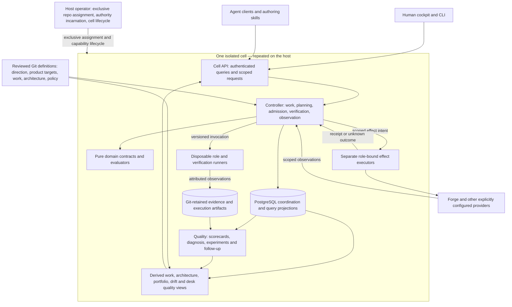

# Assay’s future architecture

> **Proposed delta, 25 October 2026:** [desk instances and rolling replacement](30-desk-instances-and-rolling-replacement.md) amends worker/review singleton assumptions below. Historical approval and deployment claims are unchanged; the delta requires its own review.

**Status: future architecture we are moving towards. Updated 21 October 2026; includes the requested extensible JSON amendment.** This is the whole-system direction for Assay, including portfolio-directed improvement and drift assessment. It describes the destination, not the currently deployed system. Detailed contract/schema amendments, implementation and activation retain their own review and qualification requirements; this designation does not approve every mechanism or grant deployment authority. The [implementation boundary](#implemented-foundations-and-work-still-to-build) below separates inspected foundations from work still to build.

The target starts with one host containing multiple isolated cells, permits command breaks where they simplify the design, reconciles affected unfinished plans together, and includes the service and cockpit in public Assay. PostgreSQL coordinates runtime work; recovery should reconstruct useful state while permitting classified transient loss and safe repeated work. See [storage and recovery](14-storage-forge-graph.md).

The maintainer ratified the whole target at revision `23f655f5d`, packages R1–R8, on [medici-finance/assay#2500](https://github.com/medici-finance/assay/issues/2500). That approval remains revision-bound: it does not imply that the portfolio/drift additions below were included in that earlier revision, or that any runtime has been activated.

## Design the product around governed operations

Build one public Assay product with a shared domain model, a durable controller for each cell, isolated execution and effect authority, and cockpit as its human client. Organize it around **intent → admission → execution → evidence → acceptance → observation**, rather than preserving cellctl, desk-tools and statusgen as three architectural pillars.

The unit of deployment is a cell. The unit of durable work is a revision-bound obligation and its attempts. The unit of acceptance is a claim supported by applicable evidence under a particular contract. The unit of improvement is an enduring operational subject, with measurements before and after a change. A successful process, delivered change, deployment, exposure and improved outcome remain different facts. This follows the direction of [PR #2492's vision](https://github.com/medici-finance/assay/blob/466c36a794bad4e837c61fe1a3335572bd458e15/docs/vision/README.md), without treating its proposed capabilities as shipped.

Start with a **modular Go application**, not a distributed service for every domain. Reuse sound reducers, protocols and tests; replace incompatible implementations. TypeScript clients can be generated from the wire contracts; no frontend framework replacement is necessary to establish the architecture. Use a small number of process boundaries where custody, untrusted execution or independent lifecycle requires them.

The diagram shows logical responsibilities; the provider-read arrow uses an authorized adapter, never ambient credentials. It does not put every box in a daemon. A planning graph is read-side context; it cannot authorize a runtime action.

## Forge service and source queries — amendment of 14 October 2026

Extend provider-effects and projection owners with one typed forge-service capability.
Agents and cockpit query an admission-bound mirror or exact-commit source view; writes go
through the existing role executor and R2 effect ledger. Confirmed provider results update
the mirror in the receipt transaction, with explicit pending/unknown outcomes and
read-after-write observation tokens. GitHub/GitLab remain authoritative for their records.
The service is initially composed in the desk module so its internal custody and Git
adapters are reused without exporting their entire capability surface.

Caller authentication, per-request scope/role authorization and provider credentials are
separate boundaries. The query service has no universal publisher credential; caches filter
current authorized inputs before private joins or counts. Immutable source results are keyed
by exact inputs and derivation version, while mutable forge facts retain freshness. Incremental
indexes reuse semantic owners, and shared Git fetch/object reuse is measured before a daemon
is introduced. See the controlling [bounded amendment](22-forge-service-and-source-queries.md)
for custody, failure, cost and rollout contracts. This later mechanism is not claimed to have
been included in the earlier whole-target ratification or to be implemented.

## One public runtime — amendment of 14 October 2026

Keep one runtime implementation in public Assay. Earlier refs-first source-control proposals
supply requirements and provenance, not another controller/store/cockpit. The
[runtime alignment](23-runtime-contract-alignment.md) selects PostgreSQL coordination,
existing Git evidence and forge ownership; preserves exact-candidate acceptance and narrow
role authority; separates offline inspection from managed admission; and routes the uncovered
evaluation-context and accountable-principal contracts. Signing, federation and a native SCM
remain separately qualified later capabilities. Historical decisions and Evidence remain.

## Portable execution environments — amendment of 16 October 2026

Use one runner boundary over independently selected, qualified harness, model and
execution-backend profiles. Workspace preparation produces a versioned readiness receipt;
launch requires effective configuration and current authority to match it. Preservation of
files, conversation, processes and pending interactions is declared separately. A restored
sandbox cannot renew ownership, budget, a human answer or permission to repeat an unknown
external effect. Show preparation, process, recovery, effects and acceptance as separate
facts through existing client/API owners.

Harness-improvement loops produce versioned, untrusted profile proposals and probe evidence.
Independent evaluation and existing review/adoption decide promotion; generated compositions
cannot rewrite enforced controls, acceptance or an active invocation's pinned bundle.

The [execution-environment amendment](27-agent-execution-environments.md) supplies the
contracts and [seven implementation briefs](../../streams/agent-execution/README.md).
They extend loop-admin and existing workspace/cell/effect owners. AX/Substrate is an optional
backend investigation; neither Redis nor another scheduler/store enters the Assay target.
Existing R2 PostgreSQL, R3 isolation, R4 role authority and R7 ingress retain ownership.
The earlier architecture ratification does not establish implementation or activation of
this later delta.

## Progressive deployment and human involvement

The running cell is the deployment unit for managed coordination and effects. Pure
work/policy/evidence capabilities also have an independently usable offline consumer
shape for inspection and advisory tasks; it does not deploy a controller, obtain
publication authority or maintain leases. The [adoption amendment](19-progressive-adoption-and-oversight.md)
defines the selected dependency closure and qualification of both shapes.

Human-involvement policy extends the work/evidence/decision owners, with the same
explainable evaluation consumed by CLI, API, controller and effect boundary. Role
identity, runtime isolation, oversight level and installation scope are distinct;
fewer Apps or quieter notifications cannot establish greater assurance or authority.
The cockpit exposes effective policy, evidence provenance and next required act.

## One semantic owner for each domain

| Domain | Meaning owned here | Boundaries |
|---|---|---|
| Definitions and planning | Work definitions, persistent product direction, product and architecture targets, requirements, contracts, change sets and their revisions | Markdown remains the narrative; structured records make selected relationships traversable. Plans do not assert deployment. |
| Work and policy | Eligibility, dependency satisfaction, delivery facts, review currency, acceptance obligations, portfolio policy evaluation and explainable holds | Pure evaluation over explicit observations and policy versions. No token minting, process launch or hidden network reads. |
| Runtime coordination | Attempts, leases/generations, schedules, cancellations, recovery, fail-closed brake budgets, best-effort pacing counts and effect intents | A simple desk item need not instantiate a general workflow graph. Both desk and workflow adapters use the same admission and ownership semantics. |
| Evidence and decisions | Evidence subjects, applicability, independent verification, human decisions, publication receipts and acceptance assessment | Execution success cannot grant acceptance; evidence publication cannot answer a human gate. |
| Provider effects | Typed external reads/writes, repository coordinates, identity, conditional effects and reconciliation | Credential custody stays outside working sessions. Each effect executor has only its role's authority; no universal credential broker. |
| Continuing operations and quality | Enduring journeys/practices/workflows, assessment definitions, due observations and improvement hypotheses | Delivery verification does not prove operational benefit. qualgen-style measures feed this domain rather than silently changing authorization. |
| Projection and interaction | Work/architecture/history, portfolio allocation and drift views, source coverage, freshness, human inbox, terminals and notifications | Same canonical evaluators for every client. Notifications and terminal attachment are not durable ownership. |
| Cell operation | Installation, resolved configuration, secrets references, executor capability, upgrades, recovery and revocation | Operator configuration remains outside evaluated branches; host administration is unavailable to agents. |

The definitions/planning domain owns the [shared discovery and handoff contract](12-future-state-model.md#discovery-and-handoff-contract) used by both author skills: source-universe enumeration, candidate relationship discovery, versioned context receipts and reviewable amendment obligations. Its offline resolver accepts explicit snapshots; authority to approve, dispatch or activate remains with the existing decision and runtime boundaries. Historical source/decision accounts are protected alongside Evidence.

These are target ownership boundaries. Existing [semantic ownership records](https://github.com/medici-finance/assay/blob/f9327a5954d57e786464e244a8e9c06f695d980d/docs/contracts.md) and implemented contracts are the migration input, not evidence that the target already exists. In particular, eligibility's implementation currently lives in statusgen; the target gives it a domain home instead of retaining a command as its conceptual owner.

Keep stable, qualified identities for a cell, repository, work definition and revision, candidate artifact, acceptance contract, attempt, lease generation, effect intent, evidence artifact and decision. Tracking repository and delivery repository are separate coordinates. An enduring operational subject and a delivery workflow instance are different types. File paths are locators, not sufficient identities.

Attempt attribution includes actor, model/provider, role/lane, candidate and source revision. Author and reviewer observations cannot overwrite each other through one mutable PR label. A label may project that record for compatibility; it is not the canonical provenance. The preservation obligations are carried into the [regression plan](15-regression-from-day-one.md).

Review currency binds the candidate actually reviewed, not solely the provider’s current `commit_id` display. The review adapter retains an attributed submission record or validated verdict binding and reports a mismatch/absence as unknown. The evaluator and publisher must share that rule, including already-ready changes, body edits and merges from base. Qualify the reported retargeting sequence before selecting the precise provider binding.

## Portfolio-directed improvement and drift

Portfolio and drift are logical capabilities within these domain owners, not a new
service, graph database or scheduler. They connect persistent intent to bounded work
and evidence of what happened afterwards. Features, capabilities and journeys can span
architectural classifications; classification and investment confer no authority.

**Persistent subjects and targets.** Extend the existing [REQUIREMENTS register](../../../spec/registers-v1.md#6-requirements-register)
with an accountable human owner, a subject kind, longer-term direction, the next target
condition and the observed condition. Targets carry a measure, window, confidence and
unique revision; observations carry source evidence, date and limits. Reference the
existing [continuing-operations](../../streams/continuing-operations/spec.md) journey or
workflow identity where applicable, preserving its ownership and assessment lineage.
The REQ carries product intent; it must not become a second operational assessment store.
A subject outlives its briefs; streams remain finite coordination of bounded changes.

**Target binding and context drift.** A brief binds the product-target revision it was
selected to serve, separately from its architecture/contract baseline. Preserve the
existing `outcome: REQ-<slug>` grammar; an additive `outcome-revision:` is a candidate
extension for the brief/schema owners, not a supported field claimed by this document.
Compare declared bindings to approved target revisions through the
[shared impact and reconciliation model](12-future-state-model.md#product-target-bindings-and-drift).
A mismatch nominates affected work for a continue, adapt or stop decision at the next
useful checkpoint; it does not automatically cancel compatible work. Urgent evidence or
control failures can require earlier action. Retain original bindings and append any
rebinding with its rationale. Unapproved proposals cannot invalidate approved work.

**Allocation and consumption.** Adopter-owned portfolio policy maps investment buckets
to subjects with separate targets for agent capacity and human decision capacity,
a scope/window and a measurement-policy revision. Work and policy evaluates eligibility;
runtime coordination admits attempts; portfolio views explain those decisions through
the same API used by CLI, agents and cockpit. They cannot dispatch independently.
A target allocation of 5% with measured consumption of 2% remains a 5% target with a
visible divergence. It does not authorize filler work, automatic catch-up or a target
rewrite. Floors, ceilings and stops apply only under explicit approved policy; required
approval, evidence and applicable obligations remain constraints.

Attribute agent consumption to stable invocation identity and the pinned runner profile,
actual model and versioned measurement/weight policy. Active time requires an approved
telemetry source; launch-to-finish elapsed time is only a labeled proxy. Count retries
and concurrent invocations once each. Measure human decisions independently using a
declared unit/window, deduplicated decision identity and one primary bucket; preserve
unattributed entries. Do not add human decision counts to agent time. Missing usage,
durations or attribution remain unknown: show known subtotals and coverage, never a
false complete total or zero. Shares with a zero denominator are undefined.

**Observation after delivery.** Bind intended impact to its signal, evaluation rule,
exposure trigger/window, evidence source and accountable observation owner. Reconcile
any concise authoring syntax with continuing-operations' impact contract before machine
use. Delivery closure transfers a still-due observation obligation to the continuing
practice; it does not erase it. A bounded manual transition may keep one owned due list
linked from the REQ until the practice integration is available. Transfer its stable
identity and history when migrating, without creating a second deadline or assessment.
Distinguish verified, exposed, used and observed claims; existing delivery lifecycle and
independent verification remain controlling. Missing exposure is an unresolved trigger,
not evidence of zero benefit. Supporting, adverse, mixed and inconclusive results remain
visible, including contradictory evidence.

**Drift views and response.** Show observed versus intended product condition,
observed versus target architecture, declared work-binding mismatches, allocation versus
consumption and due/overdue observations as distinct comparisons. Each names its subject,
baseline/policy revision, evidence window, coverage and responsible decision owner.
Compute exact mismatches and expiry only where declared inputs suffice; relationship
discovery, materiality and qualitative interpretation still need investigation. Notify
under the existing owner-approved policy, consolidating repeated divergence rather than
creating one human decision per polling tick. Raw observations, interpretations,
proposed intent and approved intent remain separate records. Drift never silently rewrites
intent or changes acceptance, runtime authority or a historical completion claim.

## Implemented foundations and work still to build

This bounded source inspection is pinned to public Assay
[`efbdb51da80746655de640e014d87324f0c2e031`](https://github.com/medici-finance/assay/tree/efbdb51da80746655de640e014d87324f0c2e031)
(13 October 2026). It is not a release inventory or deployment observation. The earlier
whole-system inventory remains pinned in the [architecture index](README.md#evidence-and-currentness).

| Capability | Implemented foundation inspected | Still to build or qualify for this target |
|---|---|---|
| Requirements and work links | `statusgen/requirements.go` parses REQ entries; `statusgen/costoutcome_test.go` covers outcome validation under brief-v1. | Persistent direction/target/observed extensions, product-target revision bindings and compatible schema/readers. Existing fields do not implement that lifecycle. |
| Context and drift | `statusgen/graph.go` exports declared work relationships. | Qualified product/architecture target resolution, coverage-aware impact reconciliation and the portfolio/drift views described above. The existing graph is not proof of this integration. |
| Runner attribution | `loopadmin/runner/request.go`, `result.go` and `usage.go` carry profile, invocation, actual-model and usage records. | Qualified active-time measurement, versioned allocation accounting, deduplication and per-bucket human-decision attribution; runner telemetry alone is not a portfolio ledger. |
| Continuing observation | The continuing-operations specification supplies design input; it is explicitly a draft. | One durable obligation/assessment chain across delivery closure and practices, exposure/usage evidence, due views and manual-to-runtime migration. |
| Whole-system runtime and clients | Existing tools and reusable contracts remain migration inputs under their present authority. | Qualify the integrated cell controller, PostgreSQL coordination/recovery, effect boundaries and shared cockpit/API consumers by the delivery and regression plans; this document certifies no deployment. |

These additions amend definitions/planning, context, work/policy, runtime measurement,
continuing operations and projection consumers. Their owners must reconcile contract
revisions, schemas, active work and migration obligations before automation. Keep
existing parsers, selection semantics, claims, verification and historical evidence
until their reviewed replacements are qualified. A manual trial must expose unsupported
semantics and coverage; it cannot claim the automated integration exists.

Qualification must demonstrate a changed target with compatible and incompatible work,
an unapproved rival with no veto, partial bindings with visible coverage, a blocked bucket
with no forced catch-up, unknown usage without false totals, and an observation obligation
that survives `done` and transfers exactly once. The [delivery sequence](16-delivery-sequence.md)
and [regression plan](15-regression-from-day-one.md) remain the homes for implementation
and proof. No refreshed complexity/churn or deployed-health baseline was collected for
this documentation revision; proceed with the bounded design update and require current
source and quality evidence in the affected implementation briefs.

## State has explicit homes

| State | Authoritative home | Consequence |
|---|---|---|
| Reviewed intent, architecture targets, work definitions, acceptance definitions | Versioned Git sources and their approval records | A candidate cannot authorize its own changed acceptance or operator policy. Runtime resolves the approved source explicitly. |
| External PR/review/issue/deployment facts | External provider, captured as attributed observations | Every read says what was covered, when, under which scope and whether complete. A page limit cannot mean an empty or complete result. |
| In-flight attempts, claims, schedules, effects and runtime coordination | PostgreSQL operational store | Transactional during normal operation; after complete loss reconstruct obligations from canonical sources, reconcile effects and repeat safe work. Some transient history can be lost. |
| Raw evidence, logs, receipts and durable exports | Git-stored retained artifacts and the existing governed publication path for this phase | Scratch can be disposable; canonical evidence needed for recovery must have a durable source; transient diagnostics need an explicit loss policy. A later non-Git evidence store needs an explicit migration. |
| Board, context graph, cockpit lists, reports and search indexes | Rebuildable projections | Show projection revision/watermark and source coverage. Display lag is not authority to repeat an effect. |

For the revised target, use **PostgreSQL in local Docker, then CloudNativePG on Kubernetes**. PostgreSQL owns operational transactions and query indexes; Git retains canonical definitions and published evidence, while the forge owns external objects. The [storage amendment](14-storage-forge-graph.md) defines HA limits, reconstruction with permitted transient loss, the forge mirror and graph queries.

Persist coordination and effect intents in SQL before execution, then reconcile outcomes. Ordinary recovery uses the database and backups; complete-loss recovery reconstructs useful state from Git/forge records and may repeat analysis or verification. It does not require a Git journal entry before every action. A reconstructed cell reconciles existing external effects and surviving runners before reopening conflicting publication.

Each cell needs separate filesystem roots, process credentials, secrets access, API scopes and resource limits. A shared PostgreSQL server can host separate per-cell databases/roles where the profile permits it. The host/database administrator remains trusted; stronger trust or availability requirements can justify separate instances. Do not confuse a namespace with isolation or a replicated database with whole-system HA.

### Repository write ownership across cells

For the first one-host profile, **one external repository belongs to one mutating cell**. The identity is provider instance plus immutable repository ID, with an explicit redirect when the provider lacks stable IDs; a cell ID is the assignee, not part of a key that makes two assignments look distinct. A trusted operator manifest assigns repositories and publication roles. Operator admission rejects overlapping assignments among managed cells before issuing executor/publisher capabilities. Separate SQL databases remain valid within these disjoint domains.

The manifest is reviewed desired state; the host's operator boundary enforces it. Descriptive topology or an upstream relationship never grants permission. Other cells may perform authorized reads or independent observation, but publication goes through the owning cell's admitted role. This is proposed enforceable ownership, not a claim that a global lock already exists.

The operator must inventory and retire/restrict pre-existing writers outside the managed host before declaring exclusive control. The first profile does not support overlapping mutation domains across independent hosts. Adding that later requires a common assignment authority and transfer contract; two valid cell-local leases are insufficient.

Cross-cell transfer pauses admission/publication for that repository, drains or cancels old work, reconciles submitted effects, revokes old capabilities/credentials, changes the exclusive assignment, and only then grants a new authority incarnation. The new cell must read historical evidence before opening. If revocation or an external outcome cannot be established, affected publication remains paused. See [handover](13-migration-and-decisions.md#handover-and-rollback-are-state-migrations) and [recovery](14-storage-forge-graph.md#authority-surviving-database-loss).

## Runtime durability without building an entire workflow platform

Implement only the durable lifecycle the first verifier needs: admit, reserve, run, collect, assess, publish/reconcile, complete or hold. A stopped controller must normally recover that lifecycle from SQL and reconcile outstanding effects; complete-loss recovery can reconstruct obligations and start safe new attempts; a terminal or agent chat must not be its memory. Reuse the existing runner protocol where it fits, then extend it once for the whole product.

Evaluate Temporal before generalizing into arbitrary durable workflows. It already supplies history and replay machinery, but external activities still need idempotency and reconciliation. It cannot decide Assay's acceptance, human authority or evidence applicability. For a single host and the first bounded verifier, I recommend the smaller transactional controller first; reconsider if the implementation starts recreating general workflow replay, versioning, distributed timers and recovery infrastructure. [Temporal event history](https://docs.temporal.io/encyclopedia/event-history), [activity semantics](https://github.com/temporalio/documentation/blob/main/docs/encyclopedia/activities/activity-definition.mdx)

Every effect carries the work/cell scope, expected revision, lease generation, policy binding and stable intent ID. A publisher checks the authorized transition and role identity, not merely the caller's role string. A failed acknowledgment produces an **unknown outcome to reconcile**, not automatic permission to repeat the write.

A lease timeout does not cancel an external request already in flight. Where a provider lacks conditional writes or idempotency, handover must drain or reconcile outstanding requests and hold ambiguous work. Do not promise exactly-once effects or safe old/new overlap on the strength of a database fencing token alone.

Independent verification uses a trusted selector for the acceptance contract, a disposable runner without publisher credentials, an attributed result, and a separately authorized publisher. Candidate code cannot edit the selector or weaken its own contract. A human decision binds a human actor, subject, revision and permitted act; agent/MCP surfaces cannot fabricate that act. Exact custody deployment remains a design decision before activation.

## Execution guards and resource lifetime

The runtime coordination owner also owns [workspace retirement and pending reevaluation](14-storage-forge-graph.md#workspace-retirement-is-a-resumable-operation). The cell-operation owner performs repository maintenance through the existing resource/runner contracts. These are responsibilities within the proposed controller, not separate schedulers or writable ownership registries. Attempt completion, accepted work, resource retirement and storage reclamation are distinct outcomes.

Efficiency guards detect repeated calls/failures, no progress and exhausted output/time/cost budgets. Emit attributed events with attempt, candidate, guard/version, triggering observation, corrective action and outcome; bound and redact stored payloads. Distinguish a model-directed nudge from deterministic refusal or cancellation. A legitimate repeated read must be able to observe changed state; equal tool arguments do not prove equal intent or stale data. Budgets come from the admitted operation profile, with explicit unavailable measurements.

Authority controls remain at the executor: scope, policy, candidate, lease generation and stable effect identity. An in-memory duplicate-call cache is only an efficiency aid; it cannot prove that a timed-out write did not occur or prevent replay after restart. A model-based comment critic may improve prose, but its failure policy must never bypass an authorization or publication check. A model's completion assessment is an attributed suggestion, not independent evidence, acceptance or permission to mark a change ready. Existing role and human gates remain controlling.

### Pacing counts are best effort; brakes fail closed

**15 October 2026 amendment.** Operation counts fall into two classes, decided by rule
rather than by example. When a count's class is unclear, it is a brake.

**Brakes stay fail-closed and are outside this tolerance.** A brake is any count that
bounds a runaway, a compromised or misbehaving writer, or the blast radius of one actor
on a target, repository, tracker or process tree. Brakes are: per-change/per-target and
per-repository write ceilings; daily write and operation caps; new-issue (filing) caps;
the write circuit breaker; the child-launch budget that bounds recursive agent launches
(graph-execution/26); per-caller ingress rate limits on the
[Cell API](21-cell-operator-surface.md); and retry budgets for provider calls
([forge service](22-forge-service-and-source-queries.md)). When a brake's count is
unavailable, unreadable or unverifiable, the governed operation holds or applies a
declared conservative fallback; it never assumes the actor is under budget. The shipped
outward-write limiter this target replaces keeps that behavior and is its reference
(at `1948dc087`: `tools/desk/internal/deskkit/ratelimit.go:23` per-target tier,
`:60` per-repository tier, `:509` unverifiable count refuses, `:807` unreadable log is
never a closed breaker; `tools/desk/cmd/deskfile/deskfile.go:267` new-issue cap). This
amendment relaxes no brake. Relaxing one is a separate human decision, recorded by the
maintainer and naming its compensating bound; nothing here makes that decision.

**Pacing counts are best effort.** A pacing count only shapes the throughput of
operations that are already authorized and already bounded by the brakes, for example
poll cadence, launch pacing, provider read-refresh rate limits
([storage and forge](14-storage-forge-graph.md)) and the reconstruction rate limit. An
enabled pacing limiter still applies its configured value to the available estimate;
this is not permission to discard the limiter or widen that value. Counting needs no
global lock across network work, no durable budget-slot reservation and no full
audit-history replay. An unavailable pacing count is reported as unavailable, never as a
measured zero; with its estimate seeded as below it does not by itself hold an
otherwise-authorized operation, and counter maintenance failure is never a publication
failure.

**Unknown usage cannot silently become a fresh allowance.** This invariant binds every
count. A brake satisfies it by holding. A pacing count's estimate is never
started at zero, and it is **shared**: no process keeps a private estimate that counts
only its own admissions.

1. An **effect-class** count (below) is always re-derived, before each admission, from
   the window's durable admission records (R2 effect intents and receipts, or recorded
   launches in the supervisor journal). That is
   a bounded query over one window, not an audit-history replay. A cached pacing row
   may exist only as an optimisation; it never counts as the source, and a skipped or
   failed row update cannot lower the estimate. Admissions by every process are
   therefore counted, so N processes or K restarts do not each spend the remaining
   allowance.
2. A **read-class** count (below) is seeded from its last retained count for the window
   and kept in one shared row that every process reads and writes back to. Row updates
   are best effort.
3. Only when a count's source (its admission records or its last retained count) cannot be read, as after a whole-database loss mid-window,
   may the estimate reset, once per window, limiter scope and operator incarnation. The
   reset is recorded and reported. A second unseeded reset in the same window, or a
   reset whose record cannot be read, treats the window as exhausted until it rolls over.

**Two kinds of pacing count.** The tie-break is the durable record: a pacing count
whose admissions leave a durable admission record is **effect-class**, and that record
governs its estimate. Admissions that commit an R2 effect intent before the executor
runs are effect-class, and so is launch pacing, whose recorded launches in the supervisor
journal ([graph-execution/26](../../streams/graph-execution/brief-26-shared-loop-admin.md))
govern it. A **read-class** pacing count paces work that leaves no durable admission
record: poll cadence, provider read-refresh and the reconstruction rate limit. Its only
seed is the last retained count, and its increments are themselves best effort, so a
missed increment is never re-derived.

**Declared drift bound (effect-class only).** C is the concurrent-admission overshoot:
at most one admission per process that re-derives the estimate between another
process's re-derive and its intent commit. Across one window an effect-class pacing count
admits at most the configured cap + C. When the single recorded reset is used, overshoot
can happen once before the loss and once after the reset, so the bound is 2 × (cap + C).
The bound holds per operator incarnation. A whole-database loss erases the reset record
with everything else, and an absent record cannot be told apart from no reset. Each such
loss already requires the operator to rotate the incarnation, so every further reset in
one window sits behind a human act. Within one incarnation, an absent reset record must
be detectable rather than read as no reset; the store that owns the records says how
([graph-execution/19](../../streams/graph-execution/brief-19-durable-instance-store.md)). Within one incarnation, a larger undercount is a
defect, not tolerated drift.

**Read-class counts have no numeric bound.** A read-class pacing count still seeds
from its last retained count, shares its estimate and obeys the one-reset rule, but it
is best effort only and unbounded on counter loss: missed increments are not recovered,
and this contract declares no limit on how many there are. That is accepted because read-class pacing shapes the
throughput of reads of already-authorized work and is not an abuse boundary. The
controls on those reads are the per-caller ingress rate limits and provider retry
budgets (both brakes), provider-enforced quotas and the hard time, cost and resource
limits.

**Residual risk.** A best-effort pacing count is not an abuse boundary. After one
unrecoverable loss an effect-class count can admit up to one extra window's cap + C of
paced, already-authorized work. Repeated whole-database loss within one window is a
named residual: each loss erases the reset record, so each operator-rotated incarnation
can admit up to one more cap + C. The incarnation rotation, not the count, is the
control on that case. A read-class count's residual is its unbounded missed increments,
as stated above. What bounds abuse is the brakes above, the executor's authority checks
(scope, policy, candidate, lease generation and stable effect identity),
provider-enforced quotas, and the hard time, cost and resource limits.

This tolerance grants no operation, target, credential or human approval. Effect
identity, duplicate prevention, ownership/fencing, required evidence and reconciliation
of unknown effects retain their existing contracts. Their durable reservations protect
an operation, not a budget slot. Provider-enforced quotas and separate time, cost,
resource or human-gate contracts are unchanged.

## Public Assay includes the control plane and cockpit

The target is **public `medici-finance/assay`** for shared contracts, controller/service, operator tools, role clients, authoring support and cockpit. The private house repository retains private cell composition, policy overlays, credentials references and operational records. Public software can operate a private cell without publicizing its contents.

Move reusable service and cockpit code through explicit, reviewed replacements. Do not export deployment-specific trees unchanged. Existing consumers keep their source and release authority until each mapped public replacement lands; a destination decision does not itself perform the move. Preserve historical identities and evidence through source-to-destination mappings, and settle any applicable sequencing decisions before activation.

I recommend **deskd/service contracts first, a thin public cockpit view during the verifier pilot, then the fuller cockpit**. The pilot should already expose its work identity, current obligation, evidence, hold reason and recovery action through the same API the final UI uses. It need not wait for Electron packaging, all terminal features, historical analytics or hosted authentication. Existing client/service contracts and useful console implementation are assets to reuse, not a reason to preserve a parallel product.

Use one versioned HTTP/JSON contract for UI and remote clients; generate a TypeScript client and offer a narrow Go client where useful. Local pure logic is an in-process API. CLI and MCP are adapters over those capabilities, with different allowed operations. Keep the existing human-action absences on agent-facing surfaces. Do not add a separate context-graph server or make every offline query require deskd.

Authorization must also cover the actual mounted/served handler graph: a correct route registry is insufficient if an extra mount bypasses its middleware. Missing authorizers and required credentials refuse; tests must exercise the served bypass and the authorized positive case. Existing per-cell rollout opt-ins remain until explicitly migrated.

Public/private authorization applies before traversal, counts, joins and cache lookup. Cross-cell queries require explicit per-cell authorization; no shared index may leak another cell's existence through counts. Configuration resolves at one boundary and carries its provenance: portable cell definition, operator overrides, deployment bindings and secrets references remain distinguishable.

### Separate operating states in the cockpit

Expose execution outcome, evidence/acceptance state, pending reevaluation, resource-retirement state and maintenance health separately, with reasons and observation times. An accepted change may retain a review workspace; a successful process may still lack required evidence. Show held resources and resumable recovery actions without turning a display action into additional authority. Explanations and aggregate resource counts obey the same cell/visibility restrictions as their source records.

## What happens to today's tools

| Today | Target disposition |
|---|---|
| cellctl | Operator surface for cell lifecycle and configuration; invocation/process supervision moves behind the shared runner contract. Existing command syntax may break. |
| desk-tools verbs | Thin adapters to typed use cases and role-bound effects. Keep an adapter only when an identified consumer needs it; do not port the entire command matrix as a milestone. |
| statusgen | Portable definition parsing, lint/evaluation/projection APIs plus an offline CLI. Execution, credential use and service lifecycle move to their explicit owners. Board-generation ownership during migration remains unchanged until its own cutover. |
| qualgen | Quality and measurement capabilities with explicit input windows and result provenance; standalone use can remain an adapter. |
| deskd / console / cockpit | Public serving and human interaction surfaces of this same product. Retire duplicated configuration, status evaluation and runtime management. |
| loopengine, drainloop, cellctl cadence, loopadmin, graph controller | One runner lifecycle and ownership contract; reuse implementations against it. Scheduling, queue policy and optional workflow progression remain separate modules, not rival launchers. |
| Installers, credential tools, monitors, communications, harvest/support tools | Keep where they have distinct consumers/authority; move shared semantics into the owning domain and route observations/effects through common contracts. They are in scope even if their command stays. |

A single Go application module for the new core simplifies internal refactors. Preserve independent modules only where an actual external library/release consumer needs that boundary. Avoid a new catch-all `common` package or publishing today's internal deskkit wholesale. New public packages need narrow, versioned contracts and a named consumer.

Command breaks are allowed; authoritative state and historical evidence still require migration. An obsolete command should fail with a useful replacement instruction rather than accidentally run against the wrong state store. The public move also needs repository-qualified identity mapping, import/pin changes and retained links to historical evidence.

## Tradeoffs and changes to previous direction

This design makes a cell service central to **online operation**, while keeping pure evaluation and offline authoring usable without it. That is a larger change than improving the existing CLIs. It adds a PostgreSQL service, explicit reconstruction and operating responsibility in exchange for removing repeated scans, divergent decisions and ad hoc recovery. The first implementation carries an [existing regression floor](15-regression-from-day-one.md).

Preserve separate role authority, operator-only credential custody, pure library reuse and retirement after consumers move. A shared online coordination/API service and any unified operator CLI need precise amendments to existing command/process contracts; permission for command breaks does not approve pooling credentials. The [public library-first contract](https://github.com/medici-finance/assay/blob/f9327a5954d57e786464e244a8e9c06f695d980d/docs/library-first.md) keeps online statusgen reads behind `deskread`; replacing that particular command seam needs an explicit contract amendment before activation. *(Amended 25 October 2026: that amendment exists. The driver's [ruling on #2395](https://github.com/medici-finance/assay/issues/2395#issuecomment-6404972196), recorded as `docs/streams/decisions/DR-forge-library.md`, supersedes `DR-forge-neutral-36`. One shared forge library for reads and writes replaces the `deskread` seam for statusgen's forge calls; it holds the role-and-repo credential in a private field with no ambient fallback, and it is a narrow package with named consumers, not deskkit exported wholesale. Activation stays behind the human gates of desktools-v2/75 and /77.)*

Do not retain every old constraint by inertia, or erase it by implication. The [migration proposal](13-migration-and-decisions.md) names the decisions and affected plans to reconcile. The [future-state model](12-future-state-model.md) makes subsequent amendments discoverable and revision-bound.

## Communications future-state amendment (proposed 13 October 2026; pending approval)

This section is a proposal against the ratified revision `23f655f5d`, not baseline text. It is pending approval and is not yet carried by the amendment manifest.

The [communications specification](24-communications.md) gives messaging an explicit
reusable client/server boundary. `commsgw` is the standalone service host; `deskd` can
compose the same service under a qualified custody profile; `deskcomms` is a client
adapter. Existing cellctl comms operations own operator configuration. A non-Go host
uses the versioned wire boundary rather than duplicating the service.

An established broker eventually owns message persistence and delivery. PostgreSQL
retains attempts, leases and business-effect intents; a transactional outbox bridges
SQL state to transport without an assumed distributed transaction. Broker transport
state has its own retention/recovery obligations. Assay owns verbs, policy, filtering
and business receipts. The initial packages retain the current file backend and trust
profile; broker selection and stronger client identity are separate qualified changes.

This amends the catch-all communications disposition above, not the authority of other
domains. The four comms-core extraction briefs are real prerequisites for their named
consumers; they do not block every R1–R8 package or unrelated supported-path fixes.

## Proposed assessment-profile alignment — 15 October 2026

[Performance and architecture profiles](../../streams/review-profiles/spec.md) apply
this direction to changed designs and enduring operational subjects. Architecture's
lead question is whether the PR moves toward the applicable future state; performance
asks whether equivalent results can use less work/contention or a better algorithm.
The assessment binds to the exact target revision, approval status and migration stage;
this addendum neither expands earlier ratification nor activates new review policy.

Definitions live with reviewed planning/quality definitions; pure policy selects
applicability; the existing runtime and future single cell controller own attempts,
budgets and cadence. Isolated workers produce canonical evidence, existing review/
decision owners judge it, and continuing operations evaluates later exposure/outcomes.
Context packets use scoped revision manifests; forge reads can reuse exact-SHA source
queries without caching mutable approval state indefinitely. Optional performance data
is a separate, consented observation copy, never acceptance or budget authority.

Local/manual calibration works before managed adoption. Later confirmed observations
may feed deduplicated issues and bounded repair draft PRs through existing admission,
effect custody, independent review/verification and post-exposure assessment. No new
scheduler, finding ledger, autonomous merger or architecture-decision authority arises.

## Tool families and CI

The [CI extension](25-ci-tooling.md) separates desk and operator clients, services,
and CI entry points while retaining these domain owners. CI produces attributed
check observations through shared libraries; acceptance stays with the existing
evaluator. Its independent delivery lane is specified in
[ci-tooling](../../streams/ci-tooling/spec.md).

## Desk-process improvement — proposal of 17 October 2026

[Amendment 22](22-desk-improvement.md) makes the existing continuing-operations/quality
domain responsible for a complete measured improvement cycle, including desk processes.
The diagram's quality box is a logical capability, not a new service or adoption authority.
Native runtime producers supply subject-bound facts; the same pure scorecards feed diagnosis,
experiments, independent assessment and follow-up. The coordinator profile owns cycle
completion, while existing human adoption and independent acceptance remain controlling.

[The public plan](../../streams/desk-improvement/README.md) separates offline availability
from native-mode qualification. Runtime evidence is implemented against the current
PostgreSQL/role/attempt owners; no replacement store, scheduler or event lifecycle is added.
Actual adopter trials, data and budgets are outside the public method. This is a new proposal,
not an enlargement of the earlier revision-bound ratification or a deployed capability.

## Attributed operational performance — requested amendment, 19 October 2026

Use the [perf-v3 contract](../../performance-attribution-spec.md) for new local tool and
runtime diagnostic observations: qualified local work references, distinct desk/assigned role,
logical session/agent identity, per-process invocation/parent links, actual forge attempts,
request durations and attributable GraphQL points with explicit unknown coverage. Desks and
launchers supply bounded environment defaults, tools expose shared parsed overrides, and each
subprocess measures its own work. No recursive parent charging or additional monitoring requests.

perfrec remains the optional local instrument with explicit tool/workflow profiles; existing
v1/v2 consent is not widened. The separate performance-collection owner imports/aliases selected
v3 data before any spool/export, without becoming operational coordination or acceptance state.
Local v3 precedes DB/API deployment. New /63–65 and amended /62, statusgen/26 and collection
briefs carry delivery; authored intent does not assert implementation, adoption or benefit.

The perf-v3 service measurements also cover the planned query/cache layer: caller-facing
logical requests and latency, per-handler/cache/coalescing work, and actual direct/passthrough
or background provider requests/cost. Keep these observation kinds distinct and charge shared
refreshes once; see the [boundary contract](../../performance-attribution-spec.md#querycache-service-and-passthrough-boundaries).

## Local write policy — amendment, 18 October 2026

The proposed [shared write-policy contract](../../write-policy.md) places deterministic
write-isolation evaluation in `deskcore/writepolicy`, with writeguard retained as the
command-hook adapter. Managed workspace owners supply validated allocation context;
the harness/container still confines actual filesystem access. This adds no generic
security service and merges no push, credential, process or cleanup authority.
Delivery: desktools-v2/66, then managed consumer integration/qualification. This amendment is proposed, not part of an earlier ratification.

Target-consumer clarification, 19 October 2026: graph-execution/22 directly consumes
/66 for the local harness boundary and independent sandbox proof. desktools-v2/31's
parser port is withdrawn (medici-finance/assay#3409 merged, ruled at
medici-finance/assay#3420), so /66 has no parser-port edge: writeguard keeps its current
parser, routed exempt, and /66 owns the hook adapter. The guard controls are not retired.

## Extensible JSON contracts — requested amendment, 21 October 2026

The future architecture uses a stable versioned core and independently versioned
extensions for durable records, component APIs and machine-readable outputs. Optional
observations can evolve without replacing an entire record; unsupported required
capabilities, authority semantics and acceptance requirements still refuse. Strict
producer validation, privacy bounds and immutable historical evidence remain mandatory.

The [contract census and transition policy](29-extensible-json-contracts.md) names
existing owners and affected JSON families, including precedents already supporting
additive fields or optional extensions. Perf-v4 is the first concrete migration:
retain v1/v2/v3 readers, qualify the new reader before selecting producers, and direct
future performance upgrades to v4. This supersedes v3 as the *future format target*
in the earlier performance amendment, not its completed implementation or evidence.

## Shared candidate and priority planning — requested 23 October 2026

The [existing efficiency specification](../../desk-workflow-efficiency-spec.md#21-candidate-plus-priority-planner--requested-amendment-23-october-2026)
owns the candidate-observation plus explicit current-policy/time/capacity plan contract.
Both prose and discrete desks consume the same role-qualified pure planner; existing
work/policy evaluators retain their meanings. Runtime coordination consumes ordered
proposals, rechecks admission and owns attempts; provider effects retain credential custody.
No new scheduler, per-role independent ranker, universal replacement score or policy store.

Use uncapped authorized source coverage, visible held/unknown/unmapped work, stable aliases
and policy/evaluator revisions. A presentation cap is not a full candidate set. Slot refill
and priority edits reevaluate supplied observations without automatically re-enumerating GH.
R6 refreshes invalidated/due source observations once per admitted scope; final consequential
checks stay fresh. Portfolio allocation remains advisory until its own qualified migration.

Delivery reuses desk-tools/39–45 and /51, graph-execution/27, desktools-v2's existing typed
query/custody boundaries and forge-neutral/37–43. Existing adopter role cutovers qualify
same-input prose/discrete parity. The ranked request model and A11–A12 acceptance live in
the efficiency spec; this pointer grants no new activation or revision-bound approval.

## Desk instances amendment — requested 25 October 2026

Worker and review roles support multiple automatically named desk instances under the existing runtime. R2 owns instance/generation records and aggregate role capacity; R3 owns instance process/workspace lifecycle. R4 role authority is unchanged. Qualified replacement starts a successor after the predecessor stops admission, while the predecessor drains; exclusive work claims and outstanding-effect reconciliation remain mandatory. See the [instance contract](30-desk-instances-and-rolling-replacement.md) for the controlling proposed delta, applied owner/brief routing and acceptance cases. This adds no implementation or activation claim.
