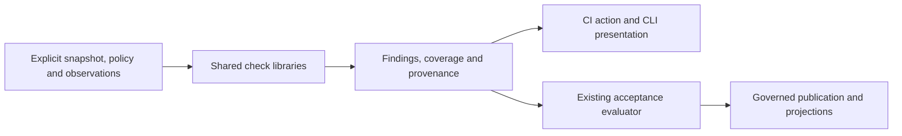

# Tool families and CI integration

**Draft extension, 13 October 2026.** The directory name `non-ci-architecture` is retained
for link stability; the proposal now includes this CI/tool-organization extension. It
adds the CI migration lane without changing the runtime activation or authority gates.
The canonical implementation contract is [ci-tooling/spec.md](../../streams/ci-tooling/spec.md),
with the [parked execution stream](../../streams/ci-tooling/README.md).

## Placement and ownership

Separate role clients (`desk/`), operator clients (`operator/`), independently operated
processes (`services/`) and CI programs/actions (`ci/`). Shared domain meanings stay with
the owners in the target architecture. A tool used by CI does not automatically become
a CI-owned domain: eligibility, evidence coverage, provider identity and acceptance keep
their existing owners. Communications clients belong to desks; gateway and drain services
belong to services, preserving their distinct authority and lifecycle.

Two refactorings support this layout. Assay-wide packages provide narrow result/provenance
and explicit repository-input mechanisms, alongside existing domain libraries. CI-wide
packages provide check implementations, rendering, invocation and action bindings. The
latter depend on the former. Neither layer imports private policy, service startup or
credential custody; pure evaluators cannot gain effects through transitive imports.
Adopter-specific implementations and policy stay in an adopter-owned private CI namespace, importing released public contracts where useful.

## CI is an evidence-producing adapter

Checks run offline without the cell controller or PostgreSQL. Provider reads, when
required, use an explicitly authorized adapter. CI success is evidence, not human approval
or acceptance by itself. Advisory exit policy never changes could-not-check into clean.
Private result visibility remains controlled even when the representation is shared.

## Delivery relative to the runtime program

1. Establish directory ownership and inventory both public staging areas
   (`ci/staged-workflows/`, `tools/ci-load/activation/`). Workflow changes land through the
   path the workflow-landing owner (desk-supervision/10–12) has in force at pickup; this
   lane never adds a staging root, and an adopter path migration updates every promoter,
   guard, drift manifest, instruction and path-dependent test together, with any
   pre-promote check selecting the new root before the first write there.
2. Publish Assay-wide and CI-wide libraries; adopt them from existing command paths.
3. Move qualified binaries and consumers to their family locations, preserving module
   boundaries, roles, pins and required-check coverage. An adopter-held tool enters the
   public tree only under its owner's recorded per-tool human publication ruling; a
   public fallback pilot keeps the lane moving without one. An old tree stays live and
   authoritative until the promoted workflow is observed running the relocated suite.
   Retain private code separately.
4. Adopt pinned reusable actions across workflows. Build the first action before or with
   the first workflow cutover; do not wait until all binaries have moved.

This lane can ship without R2–R8. It consumes the existing offline contracts and the R1
ownership direction, not the future service implementation. It does not gate the first
verifier slice on moving every tool. The layout inventory routes desk/operator/service
moves to bounded runtime work, including custody extraction before any move out of
`tools/desk/internal` visibility. The CI stream may finish while those separately tracked
moves remain; the overall tools-directory split cannot be called complete until they land.

Complete flow cutovers, qualified source retirement, explicit rollback and preservation of
historical Evidence remain the architecture's migration rules. No claimed code reduction
is a substitute for preserving an independently enforced control.
